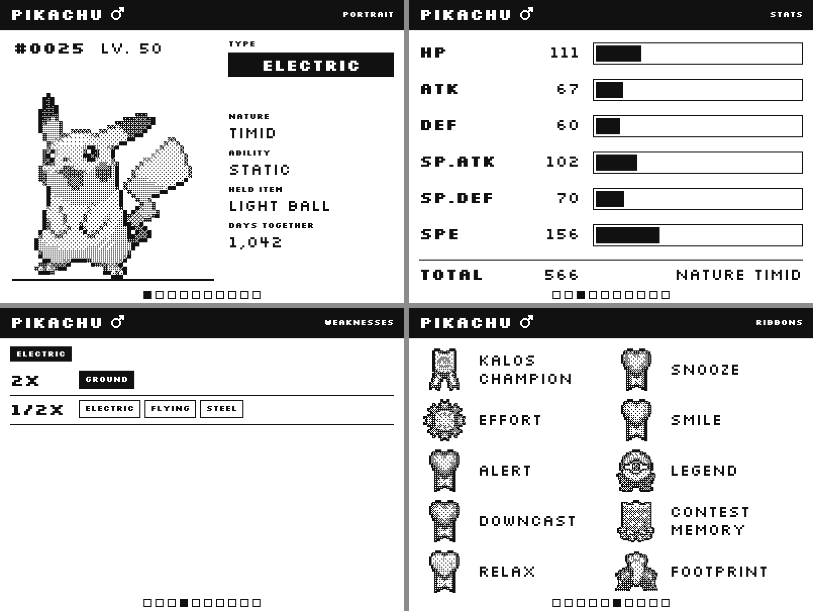
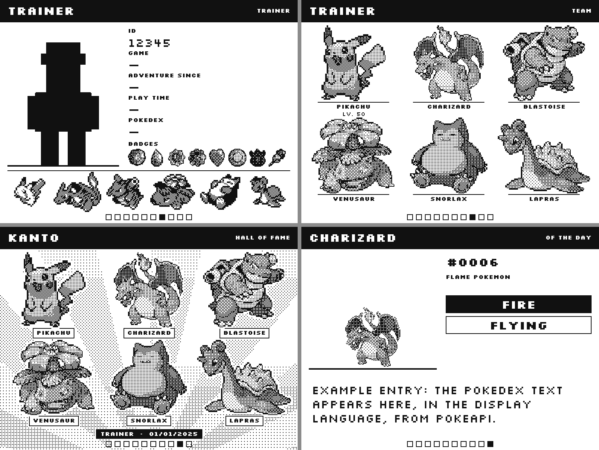
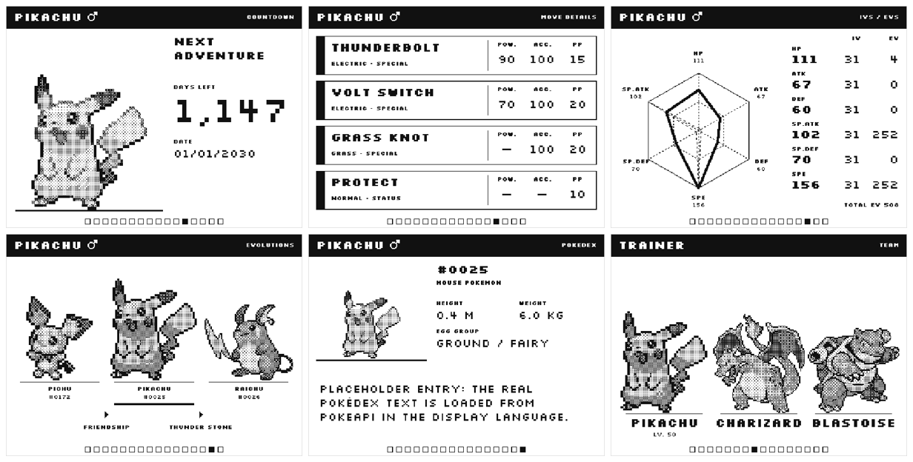
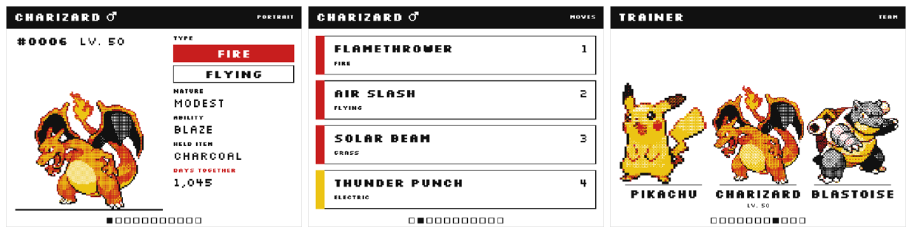

# DexFrame

  

An e-paper showcase for your Pokémon. Pick a Pokémon, fill in its card, and DexFrame renders it with crisp pixel-art sprites on a 4.2" e-ink panel — managed from a web page served by the ESP32 itself.







## How it works

- The **browser** renders the full 400×300 frame on a `<canvas>`: layout, 1-bit text, and the sprite (loaded from [PokeAPI/sprites](https://github.com/PokeAPI/sprites)).
- Sprites are scaled by **integer factors** with nearest-neighbour; shading is an ordered dither **inside each sprite pixel's block**, so the pixel grid stays sharp.
- Each card is split into **pages** (Portrait, Moves, Stats, Weaknesses, History, Ribbons, Trainer, Hall of Fame, Pokémon of the day) with 16px text for readability. Pages are stored as palette-indexed pixels with run-length compression (a few KB each, see *Frame format*) and uploaded to the ESP32, which keeps them on LittleFS and rotates them on a timer. No server, no cloud.
- The **BOOT button** (GPIO0) or an external button on **GPIO33** jumps to the next page; GPIO33 also wakes the board from deep sleep.
- The **"Days together"** counter on the portrait is redrawn by the ESP32 itself every midnight (NTP time), using a digit strip rendered by the browser — on B/W panels with a partial refresh, no full-screen flash.
- The [Silkscreen](https://fonts.google.com/specimen/Silkscreen) pixel font (OFL-1.1) is bundled in `data/www/fonts/`, so the UI works without Google Fonts.

## Hardware

| Part | Notes |
|---|---|
| ESP32 board | WEMOS LOLIN32 Lite (tested layout) or any `esp32dev`-compatible DevKit (WROOM-32) |
| 4.2" SPI e-paper, 400×300 | B/W (`GDEY042T81`) or B/W/Red (`GDEY042Z98`), e.g. WeAct Studio module; see *Panels* for the others |
| Push button (optional) | 6×6 tactile, GPIO33 ↔ GND: next page + wake from deep sleep |
| LiPo + charger (optional) | e.g. 1S LiPo + TP4056 with protection into the DevKit 5V/VIN pin; battery sense on GPIO35 via a 100k/100k divider |

| Display pin | ESP32 GPIO |
|---|---|
| VCC | 3V3 |
| GND | GND |
| SDA / DIN | 23 |
| SCL / CLK | 18 |
| CS | 5 |
| DC | 17 |
| RES / RST | 16 |
| BUSY | 4 |

Battery sensing: `BAT+ — 100k — GPIO35 — 100k — GND`. Without it, build with `-DBAT_PIN=-1`;
on another ADC1 pin, `-DBAT_PIN=<gpio>` (ADC2 pins don't work while Wi-Fi is on).

**WEMOS LOLIN32 Lite**: same wiring and the same binaries (generic ESP32, 4 MB). Notes:
- no BOOT button: the GPIO33 button is the page button *and* the reset (hold 8 s);
- LiPo on the JST PH 2.0 connector, charged from USB by the on-board charger; no on-board battery
  divider, so add the one above for the battery reading;
- its deep-sleep current is reported around 4.5 mA ([done.land](https://done.land/components/microcontroller/families/esp/esp32/developmentboards/esp32s/lolin32lite/)),
  far above a power-optimized board: a 1500 mAh cell lasts roughly two weeks even with power saving on.
  On USB this doesn't matter.
Below 3.5 V a small battery mark appears in the bottom-left corner of the page.

## Install

### From the browser (no toolchain)

Open the [web installer](https://hexlions.github.io/dexframe/) in Chrome or Edge on a computer, pick your panel,
plug the board in and press *Install*. It flashes the same factory image as below, then continue from step 3.

### Ready-made binaries

1. Download `dexframe-<panel>-factory.bin` for your panel (`bw`, `bwr`, … see *Panels*) from the
   [Releases](https://github.com/HexLions/dexframe/releases) page.
2. Flash it **at address 0x0** with the [ESP web flasher](https://espressif.github.io/esptool-js/) (Chrome/Edge, USB cable),
   or `esptool.py --chip esp32 write_flash 0x0 dexframe-bw-factory.bin`.
   The factory image contains firmware **and** web UI and erases what was on the board.
3. The panel shows the setup instructions: connect your phone to the **DexFrame-Setup** Wi-Fi,
   the setup page opens by itself (otherwise `http://192.168.4.1/setup`), pick your network.
4. Open `http://dexframe.local/` (or the IP shown by your router). The phone/PC needs internet access to load sprites.

### From source (PlatformIO)

```bash
git clone https://github.com/HexLions/dexframe.git && cd dexframe
pio run -e bw -t upload        # B/W panel   (other panels: -e bwr, -e bwry, see Panels)
pio run -e bw -t uploadfs      # web UI to LittleFS (first install only)
pio device monitor             # prints the setup / device URL
```

> ⚠️ `uploadfs` rewrites the whole LittleFS image: stored pages and saved card data are wiped.
> For later updates use the web UI (below), which keeps them.

`include/secrets.h` is optional (compile-time Wi-Fi defaults, see `secrets.example.h`).
If the saved network is unreachable, the board opens the `DexFrame-Setup` access point and keeps
retrying the network in the background; it closes the access point as soon as the network is back.

### Updates over Wi-Fi

*System* section of the web UI (or `http://dexframe.local/setup`, which is built into the firmware and
works even with an empty file system):

- **Update firmware**: `dexframe-<panel>-ota.bin` from the release, or `.pio/build/<env>/firmware.bin`.
  Pages sent with firmware 1.4.0 keep showing after the update; send them again to store them compressed.
- **Update web UI**: pick the project's `data/www` folder; files are uploaded one by one (`index.html` last),
  pages and saved data stay. Also the way to add your ribbon/trainer images without `uploadfs`.
- **Key** (optional): when set, every change to the board (pages, settings, updates, Wi-Fi) needs it.
  Without it, anyone on your network can change or reflash the board.
- **Wi-Fi**: scan and switch network from the *System* section (the board restarts and joins it).
- **Factory reset** (*System*, confirm by typing `RESET`): erases settings, Wi-Fi, key, pages, saved data and
  downloaded trainer sprites; only the web UI files stay. Export a backup first.
- **Reset**: hold the **GPIO33 button** (or BOOT on a DevKit) for 8 seconds to forget the Wi-Fi network and the key (back to setup mode).

## Day counter, Pokémon of the day, weaknesses

- **Days together**: on the portrait, counted from *Together since* (or, if empty, from the met date).
  When you press *Send*, the page also uploads the digits (`/api/glyphs`) and the position of the number;
  the firmware gets the date via NTP (or from the browser clock in AP mode) and updates the number at midnight.
  Time zone: *Display → Time zone*, POSIX format (default `CET-1CEST,M3.5.0,M10.5.0/3`, Italy).
- **Pokémon of the day**: a pool of 1–14 random Pokémon (Gen 1–4 with the Platinum/HG-SS sprites, Gen 1–5 with B/W),
  with genus, types and the Pokédex entry in the display language (PokeAPI). The board shows one per day, in turn,
  as the last page of the rotation. *New draw* picks a new pool.
- **Weaknesses**: type matchups (Gen 6+ chart) for the card's types: 4×, 2×, ½×, ¼×, 0×. Abilities such as
  Levitate are not taken into account.

## More pages

Off by default; turn them on in *Pages*.

- **Countdown**: days left to a date, with a title of your choice. The board redraws the number every midnight
  (same mechanism as the day counter) and stops at 0.
- **Move details**: power, accuracy, PP and category of the four moves (PokeAPI). Move names can be typed in
  any of the UI languages.
- **IV/EV chart**: radar of the six stats with the EV spread, and a table with IVs and EVs
  (*Stats → IVs / EVs*, `HP/Atk/Def/SpA/SpD/Spe`; filled in by the Showdown and PKHeX imports).
- **Evolutions**: the evolution line of the Pokémon with how each stage evolves; other branches are counted (`+2`).
- **Pokédex entry**: genus, height, weight, egg groups and the Pokédex text in the display language.
- **Team and Hall of Fame on several pages**: *Pages → Pokémon per page* 3 or 2 splits the six Pokémon over
  two or three pages with much larger sprites (exact 2× when they fit).

## Pages: order, timing, style

- *Pages* lists every page: tick it, move it with the arrows, and optionally give it its own **minutes on
  screen** (empty = the general *Page change* time). The Pokémon of the day always closes the rotation.
- **Quiet hours** (*Display*): no automatic page change between two times; the button still works and the day
  counter still updates. With deep sleep on, the board sleeps through them.
- **Page style**: classic black header, header in the accent ink (red on panels that have it), or light.
- **Screen upside down**: rotates everything by 180°, for a display mounted with the cable on the other side.
- **Button**: a short press is always "next page"; a double click and a 1-second press can be set to
  previous page, next page or a full refresh. With a double-click action set, a single click waits 0.45 s.
- **Low battery threshold** and **full refresh every N counter updates** (B/W panel) are settings too.
- **Download PNG** saves the page in the preview as a 400×300 image.
- *Send all pages* renders four pages at a time and skips the ones the board already holds
  (`/api/pages` returns size and CRC-32 of each), so a small change uploads one page instead of all.

## Colour



On panels with yellow or more inks (build `bwry`), sprites are dithered between the panel's inks and type
chips and move stripes take a colour by type. *Display → Preview colours* draws the preview for another
panel (including a 6-colour one that has no firmware build yet) without changing what is sent: the frames
always follow the connected display.

## Pickers: Pokémon, ribbons, badges, sprite style

- **Pokémon**: searchable by name (display language) or Dex number, with icons, for the card itself,
  the **Team** (up to 6, shown on the trainer card and on the *Team* page) and the **Hall of Fame**
  (its own team, or the trainer's).
- **Ribbons and marks**: searchable list built from the [PokeAPI/sprites](https://github.com/PokeAPI/sprites)
  catalog (`data/www/pkx/sprites.json.gz`, file names only; images load at runtime like the Pokémon sprites),
  plus your own `ribbons/legend.json` if present. Names in the display language come from the PKHeX texts.
- **Badges**: pick the region, then click the badges earned (PokeAPI badge images; Unova shows all 10, Galar 10).
- **Sprite style**: visual list of the sprite sets (Gen 1–5 game sprites).
- **Trainer sprite**: searchable list of the ~1500 Pokémon Showdown trainer sprites (`pkx/trainers.json.gz`,
  names only, `tools/build_trainer_catalog.py`). Showdown sends no CORS header, so the browser can't read the
  pixels: when you pick one, **the board downloads that single PNG** into `/www/trainers/sd/` and the page uses
  that copy. Your own pack (`trainers/legend.json`) still takes priority when present.

Team, Hall of Fame, ribbons, badges and box icons are scaled to fill their cell, so a Pikachu and an
Empoleon come out the same size; small colourful icons get a black outline so they survive 1-bit dithering.

Refresh the catalog with `python3 tools/build_sprite_catalog.py <treeless clone of PokeAPI/sprites>`.

## Collection

Save the Pokémon in the editor as a card (*Collection → Save*), load it back to edit it, reorder, delete.
With *Put a portrait of every Pokémon in the collection in the rotation* each card adds its own portrait page
(with its own day counter). Cards are part of the saved state and of the backup file.

Pages live in LittleFS next to the web UI and your images. They are compressed, so their size depends on
the content (around 5 KB for a B/W page, more with large dithered sprites or a second colour). The firmware
reports the room it has (`pageBudget`), the UI renders everything first and refuses to send what doesn't fit.
The hard limit is 48 pages.

## PKHeX import (.pk4 – .pk9)

*Pokémon → Import from a PKHeX file*: export the Pokémon from [PKHeX](https://github.com/kwsch/PKHeX)
(right-click the slot → Save file) and load the `.pk4`…`.pk9` (or `.ek*`) file. DexFrame decrypts it in the
browser and fills in species, nickname, level, nature, ability, held item, moves (with types), stats
(party stats if present, otherwise computed from base stats, IVs, EVs, nature/mint), shininess, gender,
language, OT, ID (6-digit from Gen 7), met date, region and location, characteristic and **ribbons and marks**,
matched to the icons of your `ribbons/legend.json`. Names come from the game texts in the display language.

The format data (`data/www/pkx/*.json.gz`: offsets, ribbon bits, Gen 4 character table, game texts in
Italian and English) is generated from a PKHeX checkout:

```bash
git clone --depth 1 https://github.com/kwsch/PKHeX.git /tmp/PKHeX
python3 tools/build_pkx_data.py /tmp/PKHeX
```

Tested on the 146 `.pk4`–`.pk9` files of the PKHeX test suite (all decrypt with a valid checksum and the
right species). HOME-only data (e.g. the deposit date) is not in these files.

## Showdown import

*Pokémon → Import Showdown set*: paste a set in Showdown export format. Species, types, item, ability, nature
and moves are looked up on PokeAPI (names in the display language), stats are computed from base stats,
level, EVs, IVs (default 31) and nature. History and ribbons are left untouched.

## Battery and deep sleep

With *Display → Power saving* on, the board stays online for *Minutes online* after power-on or a button press,
then deep-sleeps: it wakes on a timer to change page (no WiFi), at midnight to update the day counter,
once a day for an NTP resync, and on the GPIO33 button (which also brings the web UI back).
Waking from deep sleep resets the panel controller, so in this mode the midnight update is a full refresh;
partial refresh of the counter is used when the board stays powered (USB).
The e-paper keeps the image with no power. While asleep the web UI is unreachable: press the button first.

## Case

`hardware/dexframe_case.scad` (OpenSCAD, parametric): front bezel, back shell with LiPo cradle and DevKit rails,
USB and button openings, hanging slot, and a desk stand (15° tilt). **Measure your module board first** and set
`pcb_w`, `pcb_h`, `hole_inset` and the active-area offset; the STL files in `hardware/` use the defaults
(board 103 × 78.5 mm, panel 91 × 77 mm, active area 84.8 × 63.6 mm). Assembly: 4× M2.5 screws from the back.

## Languages

The web UI and the e-paper have **independent languages** (Italian, English, Spanish, French and German):
the switch at the top of the page sets the UI, *Display → Display language* sets what the panel shows
(labels, page titles, type names, stock ribbon names). Free-text fields you type in (nature, ability, moves,
characteristic) are shown as written. Data saved by older versions (Italian type names) is migrated automatically.

To add a language: its name in `LANGS` (`web/js/05-i18n.js`), a block for `UI`, `DISP` and `TYPE_NAMES`
(`web/js/07-i18n-langs.js`), its code in `LANGS` of `tools/build_pkx_data.py` (game texts for the pickers and
the PKHeX import), then `python3 tools/build_ui.py`. The UI test fails if a language misses a key.
The Silkscreen font covers Latin scripts only.

## Trainer card

The *Trainer* page shows a trainer sprite, ID, game, start date, play time, Pokédex count,
8 badge slots and a team row of up to 6 Pokémon (box icons fetched from PokeAPI by Dex number).

DexFrame ships **no** trainer artwork. Either upload an image from the *Trainer* section (it is
cropped, reduced to at most 96 px and stored with your card), or put your own PNGs in
`data/www/trainers/` with a `legend.json` in the same format as the ribbons one
(`png`, `name`, and either `origin_gen` or a `variant` like `gen3`) to get a searchable chooser with a generation filter.
You can also load a sprite at render time from a URL of your choice: set *Trainer sprite base URL*
and *Sprite file*; the source must allow cross-origin loading (the UI shows ✓/✗).
Without an image, an original generic silhouette is drawn. `data/www/trainers/*` is git-ignored.

## Hall of Fame

A page with the whole team (sprites in the chosen style, names from PokeAPI in the display language),
the region in the header and trainer + date at the bottom. The background is either an image you upload
(cover-cropped, stored as a small JPEG with your card, drawn as faint dither) or an original light-ray
backdrop. *Background strength* sets how light it is; sprites get a white halo so they stay readable.

## Backup

*Backup → Export configuration* downloads everything as `dexframe-<name>-<date>.json` (card data,
ribbon and trainer choices, team, Hall of Fame, languages, uploaded images). *Import configuration…*
restores it. Images from your own folders are not included, only which ones you picked.

## Driving the display from a PC (large image sets)

Big image sets don't fit the ESP32 (a 1500-sprite trainer pack is ~2.8 MB; LittleFS has ~1.4 MB).
The board doesn't need them: it only stores the rendered pages (a few KB each).

1. Build a single file with everything embedded:
   `python3 tools/make_standalone.py . --trainers ~/my-trainer-pack`
2. Open `dexframe.html` on your PC, set *Display → Display address* to `http://dexframe.local`
   (or the board's IP) and press Enter. The firmware answers with CORS headers for this.
3. *Send all pages* as usual. Some browsers ask once for permission to access devices on the local network.

To keep a few trainers in the UI served by the board itself:
`python3 tools/select_trainers.py ~/my-trainer-pack cynthia red koga-gen3`, then `uploadfs`.

## Ribbon images

By default ribbons and marks come from the [PokeAPI/sprites](https://github.com/PokeAPI/sprites) catalog and
load at render time, like the Pokémon sprites; nothing is stored in this repository. To use your own icons instead
(or as well), drop PNGs (transparent background, any size) into `data/www/ribbons/` with a `legend.json`
(see `legend.example.json`), then *System → Update web UI* (or `uploadfs` on a new board):

- Or load them at render time from a URL of your choice: set **Image base URL** in the *Ribbons* section, and give
  each line a file name: `Contest Memory | some-file.png`. The source must allow cross-origin loading (CORS).
- Every icon is scaled to the same size, outlined and dithered for e-ink (reds go to the red plane on B/W/R panels).
- Ribbons without an image get a generic rosette.
- `data/www/ribbons/*` is git-ignored, so your images stay local.

## API

| Method | Path | Body |
|---|---|---|
| GET | `/api/info` | → `{w,h,api,panel,panelName,palette,bpp,partial,pageBudget,red,maxSlots,slotsFit,count,daily,entries,current,interval,sleep,awake,timeValid,today,batteryMv,fsUsed,fsTotal,version,ap,ssid,host,keySet,busy}` |
| POST | `/api/frame?slot=N[&ov=x,y,w,h,align,startDay,color,sep]` | multipart file for slot N (0–47), a DXF1 frame of the panel's size (see *Frame format*); `ov` = day-counter box, `color` 0 black, 1 red, 2 yellow…; two optional fields more: `mode` (0 days since, 1 days until) and `scale` (1–4) |
| GET | `/api/pages` | → `[{slot,size,crc,ov}]` for the stored pages (CRC-32 of the file) |
| POST | `/api/glyphs` | multipart file: digit strip for the day counter (`[gw,gh,n,adv[n],bitmaps]`) |
| POST | `/api/rotation` | form: `count` (regular pages), `interval` (minutes, `0` = button only), `daily` (pool size, slots after the regular ones), `sleep` (0/1), `awake` (min), `qf`/`qt` (quiet hours, minutes of the day, -1 = off), `iv` (minutes per rotation entry, comma separated, 0 = default), `flip` (0/1), `dbl`/`lng` (button actions: 0 none, 1 next, 2 previous, 3 full refresh), `batlow` (mV), `fullevery`, `tz` (POSIX), `now` (epoch s) |
| POST | `/api/next` | show next page |
| POST | `/api/show?slot=N` | show page N |
| GET/POST | `/api/state` | card data JSON (≤64 KB) |
| POST | `/api/ota` | multipart firmware `.bin` (app image), restarts when done |
| GET | `/api/fs[?dir=/www]` | → `[{path,size}]` |
| POST | `/api/fs?path=/www/…` | multipart file, written below `/www/` only |
| POST | `/api/fs/delete?path=/www/…` | delete a web UI file |
| GET | `/api/wifi/scan` | → `[{ssid,rssi,secure}]` |
| POST | `/api/wifi` | `ssid`, `pass`, `host` → saved, restart |
| POST | `/api/wifi/forget` · `/api/key` (`new`) · `/api/reboot` | |
| POST | `/api/trainer?f=<file>.png` | board downloads that Showdown trainer sprite to `/www/trainers/sd/` |
| POST | `/api/reset?confirm=RESET` | factory reset (keeps the web UI files) |
| GET | `/setup` | built-in setup/rescue page |

When a key is set, every `POST` needs `?key=…`; `GET` requests stay open.

## Panels

One firmware build per panel; the web UI asks the board what it has (`/api/info`: size, inks, partial refresh)
and renders for it.

| Build | Panel | Inks | Notes |
|---|---|---|---|
| `bw` | 4.2" 400×300 `GDEY042T81` | black, white | fast partial refresh: the day counter updates without a flash |
| `bwr` | 4.2" 400×300 `GDEY042Z98` | black, white, red | full refresh only (~16 s) |
| `bwry` | 4.2" 400×300 `GDEY0420F51` | black, white, red, yellow | **experimental**: builds, not tested on hardware; yellow is not used by the pages yet |

Adding a panel that [GxEPD2](https://github.com/ZinggJM/GxEPD2) supports is a block in `include/panel.h`
(driver class, inks, partial refresh), an env in `platformio.ini` and an entry in the CI matrix
(`.github/workflows/build.yml`). The page layouts are still drawn for 400×300: other sizes need the layout
work listed in the roadmap.

## Frame format

A page is a `DXF1` file (`include/frame_codec.h` has the decoder, `encodeFrame()` in `web/js/` the encoder):

- 12-byte header: `"DXF1"`, width and height (u16 little-endian), bits per pixel of literals (1–4), 3 zero bytes;
- then tokens until width × height pixels are covered, row by row:
  - `0cccllll` — run of ink `c`; `llll` + 1 pixels, or 16 + a LEB128 varint when `llll` is 15;
  - `1nnnnnnn` — `n` + 1 literal pixels (128 + varint when `n` is 127), packed at bpp bits each, MSB first.

Ink codes: 0 white, 1 black, 2 red, 3 yellow, 4 blue, 5 green, 6 orange. An ink the panel lacks is drawn black.
The board checks the whole stream on upload and draws it run by run, without holding the frame in RAM.
Raw two-plane pages from firmware 1.4.0 (30000 bytes) are still accepted on 400×300 panels.

## Web UI sources

`data/www/index.html` is generated: edit `web/` (`index.template.html`, `style.css`, `js/NN-name.js`) and run
`python3 tools/build_ui.py`. The script only joins the files in name order, with no bundler or minifier, so the
file the board serves stays readable. CI fails if the generated file is not up to date.

## Web installer

`installer/index.html` plus `tools/build_installer.py` make a small site with
[ESP Web Tools](https://esphome.github.io/esp-web-tools/): one manifest per panel pointing at the factory
image, and the ESP Web Tools files copied next to the page (taken from the npm package at build time, nothing
is loaded from a CDN). CI builds it on every run and publishes it to GitHub Pages when a `v*` tag is pushed;
the repository needs *Settings → Pages → Source: GitHub Actions*.

## Tests

```bash
python3 tests/test_codec.py    # web UI encoder against the firmware decoder (needs node, g++)
python3 tests/test_ui.py       # web UI against a fake board, every panel type (needs playwright + chromium)
```

Both run in CI on every push, next to the firmware builds.

## Roadmap

- [x] Single Pokémon card, rotating pages (incl. Trainer card, Hall of Fame, weaknesses)
- [x] Collection of saved cards in the rotation
- [x] Day counter updated by the board, Pokémon of the day
- [x] Showdown import, deep sleep + battery, 3D-printable case
- [x] PKHeX file import, setup portal, updates over Wi-Fi, ready-made binaries
- [x] Team view
- [x] Panel description from the firmware, compressed palette frames, one build per panel
- [x] Page order and per-page timing, quiet hours, button actions, 180° screen, page styles
- [x] Countdown, move details, IV/EV chart, evolutions, Pokédex entry, team on several pages
- [x] Spanish, French, German
- [x] Colour on the 4-ink panel (sprites and type colours quantised to the panel's inks), colour preview
- [x] Web installer (flash from the browser)
- [ ] 6-colour panels (firmware build; the web UI can already preview them)
- [ ] Layouts that adapt to other panel sizes (2.9", 7.3")

## License

GPL-3.0. File formats, ribbon data and game texts for the PKHeX import are derived from
[PKHeX](https://github.com/kwsch/PKHeX) (GPL-3.0) by Kaphotics and contributors. Silkscreen font: SIL Open Font License 1.1 (`data/www/fonts/OFL.txt`). Pokémon names, sprites and artwork are © Nintendo / Creatures Inc. / GAME FREAK inc.; DexFrame ships none of them and fetches sprites at runtime from PokeAPI. Not affiliated with Nintendo.
